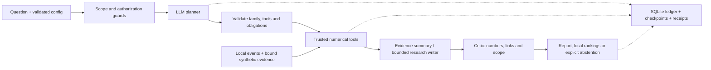

# BLACKGRID

BLACKGRID turns network-science questions into bounded, reproducible investigations. A constrained LLM planner chooses registered tools for community testing, centrality, cross-community bridges and temporal link prediction; trusted numerical code executes the analysis, and evidence checks constrain the answer to what the artifacts support. A local console exposes reports, private rankings, uncertainty, refusals and costs. Durable checkpoints, verified receipts and explicit spending caps keep interrupted investigations auditable. Separate synthetic studies demonstrate Bayesian beliefs, experiment decisions and causal-identification limits.

[Technical summary: two-page PDF](output/pdf/blackgrid_technical_summary.pdf) · [Markdown](docs/technical_summary.md) · [Detailed system flowcharts](flowchart.md) · [MIT license](LICENSE)

## Architecture



Models receive aggregate evidence, not raw event rows or local identifier tables. Validated structural and forecast summaries use evidence templates by default; model-written summaries remain bounded by the same critics. See the [full architecture](flowchart.md) for recovery, follow-up and evaluation paths.

## Headline results

| Measurement | Observed result | Scope and evidence |
|---|---|---|
| Current complete regression | **493 passed; 0 failures, errors or skips** in 4m26s | Engineering and numerical checks, including offline instrumented providers. [Test status](docs/current_test_status.md). |
| Most recent real-LLM system evaluation | **23/24 strict passes (95.8%)** in 108s; batch cost **$0.0089** | Current post-repair snapshot: 17/18 supported questions passed; all 6 unsupported requests were refused (5 guards, 1 model). One research-writing response truncated. [Evaluation and limitations](docs/current_system_evaluation.md). |
| CollegeMsg repeat-pair prediction | **40.8 correct per top 100**; mean AP **0.2883** | Logistic model averaged across 5 inspected rolling development windows. [Saved results](results/sprint06-v2/summary.json). |
| CollegeMsg first-time pair prediction | **4.4 correct per top 100**; mean AP **0.00757** | Same development protocol; first contacts remain difficult. These scores are not calibrated probabilities. [Saved results](results/sprint06-v2/summary.json). |
| External prediction confirmation | Logistic model beat its registered reference in **5/5 windows for each task** on Bitcoin OTC | Dataset/task-specific confirmation, not universal transfer. [Saved results](results/sprint06-v3-bitcoin/summary.json). |

The latest live evaluation used reused data and warm numerical caches, with independent numerical checks plus assistant semantic review. All bridge cases passed; one saved synthetic research answer failed when the model hit its output cap. Earlier evaluations remain separate. These measurements do not establish autonomous scientific discovery, causal influence, calibrated individual probabilities or a statistically demonstrated benefit from an LLM. The [technical summary](docs/technical_summary.md) separates the thesis, method, results and limitations.

## Start here

```powershell
uv sync --frozen
uv run --frozen pytest
uv run --frozen blackgrid console
```

The default console is local and uses scripted AI with real numerical tools. CollegeMsg must be supplied locally with the recorded checksum and usage decision; raw datasets are not redistributed. For explicitly authorized live operation under an absolute $3 project ceiling:

```powershell
uv run --frozen blackgrid console --allow-paid --max-usd-total 3
```

That ceiling includes previous spending and unresolved reservations; it is not a fresh $3 grant. Refresh the console and select **Real AI**. Setup, dataset requirements and recovery commands follow below.

## License

Original BLACKGRID code and documentation are available under the [MIT License](LICENSE). Third-party datasets, dependencies and assets retain their own terms; this license grants no rights to CollegeMsg, Bitcoin OTC or other third-party data. Raw data, credentials and private run artifacts are excluded from version control.

<details>
<summary>Historical sprint implementation notes</summary>

These notes retain the results and status of their respective revisions. Historical test counts, spending and capability statements are not the current project totals. Sprint plans remain local under ignored `sprints/`; implementation reports are versioned in `docs/`.

**Sprint 7's initial synthetic uncertainty/decision slice is implemented.**
`blackgrid sprint7 --output runs/NEW` demonstrates reliability diagnostics,
Bayesian belief updates, exact one-step experiment value and causal identification
checks in free mock mode. Open the run's `report.html` or inspect it in the console.
Real forecast probabilities and real-world causal effects remain unsupported.
The main console/planner can now review that evidence: select **Review research
evidence**, or ask about posterior beliefs, calibration uncertainty or the next
experiment. It inspects the completed `runs/sprint7-final` reference with pinned
evidence identity; it does not execute new model-directed experiments.
See the [guide](docs/sprint07_guide.md) and [results and remaining scope](docs/sprint07_report.md).

**Sprint 6 is implemented: baseline-first temporal link prediction** ([report](docs/sprint06_report.md),
[simple guide](docs/sprint06_guide.md)).
- `blackgrid predict-eval` runs the frozen, sealed-test evaluation; `blackgrid forecast` produces a known-node
  forecast, viewable in the console as **Forecast connections**.
- prediction-v2 (`blackgrid predict-rolling`, development evidence): a logistic model on time-decayed features beat
  the v1 winners in 4/5 rolling windows; the pre-registered boosted-tree model did not (D-076).
- prediction-v3 (`blackgrid predict-confirm`): on unseen Bitcoin OTC data the v2 logistic model beat the v1 winners
  in 5/5 windows in both tasks; the improvement is confirmed under a frozen protocol (D-078).
- The confirmed logistic_v2 model is now the default forecaster wherever its confirmation holds; forecasts cite the
  rolling and Bitcoin evidence (D-079).
- Forecasting is integrated into the agent: ask a "who will message next" question in the console. The AI planner
  picks the forecast tools, and a forecast checker verifies every statement (D-074).
- Recent-activity methods beat static ones in both tasks. New connections remain hard to predict (AP about 0.002 at a
  base rate of 5.5e-5). Repeat interactions reach AP 0.14–0.40.
- USD 0; reproduced exactly in a clean environment.

**Sprint 5's offline structural capability is implemented.** The arsenal now has seven tools, question-specific plans,
one bounded follow-up round, local centrality/bridge rankings and evidence inspection in the console.
See [usage](docs/sprint05_guide.md) and [evaluation and limitations](docs/sprint05_report.md).
The 48-run scripted evaluation and clean reproduction work. Real-model trials and a budgeted console are now available;
see [the live trial and UI report](docs/sprint05_live_report.md). Small successful checks do not establish an advantage from adaptive planning.

```powershell
uv run --frozen blackgrid run configs/collegemsg_sprint01.json --family auto --question "Which nodes connect different groups, and are the rankings stable?"
```

**Sprint 4 is complete as scoped** ([report](docs/sprint04_report.md)).
- R1–R5 are fixed, each with a regression test.
- A fresh, frozen offline evaluation (`blackgrid sprint4 --output runs/NEW`) ran 72 of 72 runs.
- The workflow reproduces identically in a clean locked environment.
- critic-v3 stops the scripted mock's unsupported claims. A rule baseline still matches or beats the agent arm, because
  one "preregistered" wording is accepted by the critic but rejected by the reviewer.
- No human has reviewed claims: the AI review was accepted and the human gate waived by the user (D-059). USD 0 spent.

**Sprint 3's offline scope is implemented and evaluated.** It adds 24 fresh
synthetic validation cases, paired mock evaluation with independent artifact scoring,
an actual CPU Louvain–Leiden comparison, and blinded claims for human review.
The critic still lets unsupported claims through. Read the
[measured results and limitations](docs/sprint03_report.md) or
[plain-English guide](docs/sprint03_guide.md). Full CollegeMsg ingestion is also
applied; see [usage and scope](docs/FULL_DATA_INGESTION.md). Historical experiments
and the Louvain default are unchanged. Human review and real-model efficacy remain pending.

**Sprint 2 is implemented.** Investigations now run as a resumable LangGraph workflow with durable operations, persisted budgets, authorization pauses, cancellation, and crash recovery, plus an interactive console. 187 tests pass, including fixes from a third external review (D-048). The frozen science is identical to Sprint 1's reference, recomputed in a clean offline environment.

**One live Sprint 2 run** (user-run, `deepseek/deepseek-v4-flash-0731`) **completed** with both required analyses:
- the real model's 4 claims were accepted by the critic on the first draft;
- no charge exceeded its reservation;
- it cost USD 0.0016 (D-049).

Project spend so far: USD 0.0067.

Sprint 1 is implemented (Days 1–14). The mock pipeline is reproduced from a clean environment.

Five exploratory live runs have been made, costing $0.0051 in total. One completed, with verdict `not_supported`, but it skipped the required missing-edge analysis, so it counts as partial (D-041).

Fixes from an external review are in, but none has been exercised live yet:
- meaning-aware number checks (D-038);
- hard spending caps (D-039);
- a `partial` status for incomplete answers (D-040).

See `docs/sprint01_report.md` for acceptance criteria, results, and limitations.


</details>

## 1. Setup (once)

You need Python 3.11 and [uv](https://docs.astral.sh/uv/). From the repository root:

```bash
uv sync --frozen
```

The raw dataset is not redistributed (D-003). Put the SNAP CollegeMsg file at `data/CollegeMsg.txt/CollegeMsg.txt`; its SHA-256 must be `e00ba2415373dee52c00616065bcceaa4750e78de60d1855c76470600f10740f`.

## 2. Run the tests

```bash
uv run --frozen pytest
```

## 3. Run the CollegeMsg investigation, free and offline (mock mode)

```bash
uv run --frozen blackgrid run configs/collegemsg_sprint01.json
```

The first run takes about 1.5 minutes: the experiment plus 20 sensitivity replicates. Repeats use the cache and take seconds; add `--no-cache` to recompute everything. The command prints the run folder. Inside it:

- `report.md`: the evidence-linked report;
- `report.html`: the visual console;
- `manifest.json`: hashes, seeds, tool calls, cost;
- the raw artifacts.

To compare with the unvalidated condition (no plan validator, no critic):

```bash
uv run --frozen blackgrid run configs/collegemsg_sprint01.json --condition tool_only
```

### Use the whole dataset (exp-v2-full, exploratory)

The command above analyses the preregistered **first week** (196 messages, 104 people). To analyse **every message** in CollegeMsg (59,835 messages, 1,899 people, 13,838 connections):

```bash
uv run --frozen blackgrid run configs/collegemsg_full.json
```

For a live, paid run:

```bash
uv run --frozen blackgrid run configs/collegemsg_full_live.json --allow-paid
```

The full-dataset run:

- **Takes about 12 minutes** the first time, and seconds when cached.
- **Is a separate, exploratory experiment** (`protocols/full_dataset_experiment.md`). It uses the same method and safeguards, with fewer nulls for runtime: 99 nulls, and a missing-data check of 5 replicates × 19 nulls.
- **Never changes or replaces the first-week result.**

`blackgrid ingest` (`docs/FULL_DATA_INGESTION.md`) only *describes* the full file. `collegemsg_full.json` runs the community test on it. The console's "Start mock run" button can run either scope.

## 4. Run the mock pilot (8 synthetic cases × 2 conditions)

```bash
uv run --frozen blackgrid pilot
```

## 5. Open the console

The interactive console runs locally:

```bash
uv run --frozen blackgrid console
```

Then open http://127.0.0.1:8765.

- **It updates live while runs progress.** You can browse every run and pilot.
- **It can act on runs:** start **mock** runs and the pilot, and resume, cancel, deny, or reconcile runs.
- **Paid calls are disabled by default.** Starting with `uv run --frozen blackgrid console --allow-paid` enables a retained
  USD 0.50 allowance shared with the live trial. Restarting does not refill it. The browser cannot create a new allowance.
  To explicitly authorize an absolute project ceiling instead, use
  `uv run --frozen blackgrid console --allow-paid --max-usd-total 3`.
  This includes all previous project charges and unresolved reservations within USD 3; it does not add USD 3
  or reset spending. It uses a separate retained project authorization and preserves the historical trial allowance.
  Refresh the page and select **Real AI** before starting a paid investigation.
- **It is local only.** It listens on 127.0.0.1 and protects actions with a per-session token.

Every finished run also saves the same console as an **interactive offline snapshot**:

- `runs/<run>/report.html` for each run;
- `runs/<pilot>/pilot.html` for each pilot;
- `runs/index.html` listing every run.

Double-clicking a snapshot works. Rebuild all snapshots with:

```bash
uv run --frozen blackgrid ui
```

The console shows:

- the experiment: observed modularity against the null distribution, ΔQ, z, and p;
- the projected network, coloured by degree and **not** by community;
- the missing-edge sensitivity analysis;
- the agent trace: planner → validator → tools → analyst → critic;
- accepted and rejected claims with reasons;
- the full report and the budget meters.

**Prediction:** Sprint 1 has no predictive model (graph prediction is gated to Phase 3). The UI says so rather than showing invented predictions.

## 6. Live LLM run with OpenRouter (costs money)

Live mode sends **only aggregate statistics and the task text** to the model. It never sends raw events or user IDs. It needs three things:

1. Your key and model in `.env`, which is git-ignored. `.env.example` is the template:
   ```
   OPEN_ROUTER_API_KEY=...
   OPEN_ROUTER_MODEL=anthropic/claude-haiku-5.5
   ```
   - `OPENROUTER_API_KEY` and `OPENROUTER_MODEL` are also accepted.
   - The model in `.env` overrides `llm.model` in the config. The run's saved `config.json` records the model actually used.
   - The default `anthropic/claude-haiku-5.5` is listed and priced on OpenRouter, but its endpoint returned HTTP 404 (D-041). `deepseek/deepseek-v4-flash-0731` has completed a run. Pick any ID from https://openrouter.ai/models. A model ID that isn't listed stops the run before any spending. A listed model whose endpoint fails costs at most the booked reservation of two attempts.
2. `configs/collegemsg_live.json` (`mode: live`, `paid_execution_authorized: true`).
3. The `--allow-paid` flag on the command line. Without it, a live run **pauses** before its first paid call, and you can approve later with `blackgrid resume RUN_ID --allow-paid`.

```bash
uv run --frozen blackgrid run configs/collegemsg_live.json --allow-paid
```

Before any call, BLACKGRID fetches the model's current price from OpenRouter; if it cannot, it refuses to run.

Every call is reserved at its worst case before it is sent: a strict bound on the input, the full `max_tokens` output, at 2× list price. A failed call is booked at its whole reservation. A charge above its reservation stops all further paid calls. The reservation is checked against these caps:

- 8 calls, 100,000 tokens, and USD 0.50 per run (live configs allow up to 16,000 output tokens per call);
- USD 10 for the whole sprint, tracked in `runs/spend_ledger.json`;
- 1 retry per failed call, 2 revision rounds.

A typical validated run makes 2–4 calls.

To re-run a live investigation for free, replay its recorded responses:

```bash
uv run --frozen blackgrid run configs/collegemsg_sprint01.json --mode replay --replay-from runs/<live_run_id>
```

## Pause, resume, and recovery

Every step of a run is saved, so an interrupted run continues where it stopped without repeating finished work or charges. See `docs/workflow_guide.md` for a restart example.

| Command | What it does |
|---|---|
| `blackgrid status` | List runs |
| `blackgrid status RUN_ID` | Stage, required/completed/missing analyses, remaining limits, pause reason |
| `blackgrid resume RUN_ID` | Continue. Add `--allow-paid` to approve a paused live run. A run whose worker crashed is taken over automatically once that process has exited. A live worker is never displaced, even during a long tool call. Use `--force-unlock` only if a process is alive but truly stuck. |
| `blackgrid cancel RUN_ID` | Stop at the next safe step |
| `blackgrid deny RUN_ID` | Refuse paid execution |
| `blackgrid reconcile RUN_ID --retry` or `--stop` | Resolve a paid call whose outcome is unknown. It is never resent automatically. |

## Exit codes

| Code | Meaning |
|---|---|
| `0` | completed |
| `1` | invalid config, or live mode not authorized or not priced |
| `2` | the run did not fully complete (partial, abstained, failed, cancelled, denied, or budget exhausted); see `manifest.json` |
| `3` | paused: waiting for authorization or reconciliation (`blackgrid resume`) |

## Layout

Source code lives in `src/blackgrid/`, grouped by responsibility (reorganized in D-082):

| Package | Modules | Purpose |
|---|---|---|
| `blackgrid/` | `cli.py`, `__main__.py`, `contracts.py` | Command line, and the typed contracts shared by everything |
| `data/` | `collegemsg.py`, `datasets.py`, `ingestion.py`, `synthetic.py` | Loading and validating event data (CollegeMsg, schema-driven datasets), full-data ingestion, synthetic graph generators |
| `analysis/` | `experiment.py`, `sensitivity.py`, `structural.py`, `methods.py`, `parity.py` | Graph science: modularity vs degree-preserving null, missing-edge sensitivity, centrality and bridges, Louvain/Leiden comparison |
| `agent/` | `roles.py`, `tools.py`, `critic.py`, `inquiry.py`, `providers.py`, `budget.py`, `report.py`, `live_allowance.py` | The AI agent: role prompts and inputs, allowlisted tools, plan validator and claim critic, question routing, mock/OpenRouter/replay providers, budget ledger, evidence-linked reports, live allowance |
| `workflow/` | `engine.py`, `api.py`, `store.py`, `runner.py` | Durable LangGraph workflow, start/resume/cancel API, SQLite operation store, run orchestration |
| `prediction/` | `temporal.py`, `scores.py`, `features*.py`, `model.py`, `metrics.py`, `fast.py`, `suite.py`, `rolling.py`, `service.py`, `claims.py`, `synthetic.py` | Temporal link prediction: cutoff-safe pipeline, heuristics, models, sealed and rolling evaluation, forecast tools and predictive-claim checker |
| `evaluation/` | `benchmark.py`, `validation.py`, `scoring.py`, `pilot.py`, `sprint3.py` … `sprint5_live.py` | Dev benchmark and validation cases, independent scoring, mock pilot, the frozen sprint evaluation suites |
| `console/` | `server.py`, `data.py`, `render.py`, `template.html`, `ui.py` | Local interactive console and saved snapshots |

Other folders:

| Path | Purpose |
|---|---|
| `tests/` | Offline test suite (`uv run --frozen pytest`) |
| `scripts/` | Verification, replay, export and archive helpers |
| `benchmarks/` | Split policy and public dev registry; `sealed/` is reserved and git-ignored |
| `configs/`, `protocols/`, `docs/` | Run configs, frozen protocols, decision log, reports and guides |
| `results/` | Aggregate-only, shareable result summaries |
| `data/` | Raw inputs, read-only and not tracked (only `data/manifests/` is tracked) |
| `runs/` | Run artifacts, local rankings and UI pages, not tracked |

## Data citation

CollegeMsg: Panzarasa, Opsahl & Carley (2009), *JASIST* 60(5):911–932. Opsahl & Panzarasa (2009), *Social Networks* 31(2):155–163. Source: https://snap.stanford.edu/data/CollegeMsg.html. Use is local and non-commercial under D-003, with no raw redistribution.
