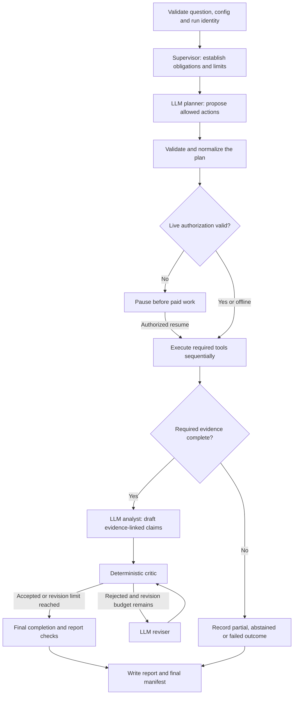

# BLACKGRID - Sprint 2: a dependable agent workflow

Planning date: 18 October 2026.

Status: plan and architecture decisions only, as requested. No implementation, dependency installation, experiments, paid calls, or existing repository edits are authorized by this document. Proposed repository location when adopted: `C:/Blackgrid/SPRINT_02.md`.

## 1. What we are building

Turn the existing planner, tools, analyst, and critic into one visible, resumable workflow that remembers what has happened and knows what remains unfinished.

The user should be able to start an investigation, see its current step, pause it, close the program, and continue later without losing completed work or accidentally repeating a paid call. If the program cannot tell whether a paid request completed, it stops for reconciliation instead of blindly retrying.

The first demo remains CollegeMsg. The scientific question, graph construction, Louvain experiment, and missing-edge check remain fixed. This sprint improves how the research agent operates; it does not try to produce a more exciting scientific result.

Plain-English success statement:

> "BLACKGRID chooses an allowed research plan, runs everything the question requires, checks the explanation, and can resume safely after an interruption. I can inspect each step and its cost."

## 2. Size and schedule

**Six work sessions, about 12 focused hours, plus a two-hour contingency.** A session is roughly two hours and does not have to occupy a full calendar day. Spread them across about one week if convenient. This replaces another fourteen-day checklist.

The 12 core hours fit Sprint 2's share of the roughly 100-hour project target. The two-hour buffer is contingency, not a reason to add features. Actual time already spent on Sprint 1 should be recorded separately rather than pretending its original estimate is actual effort.

Include learning, building, and verification in these hours. End each session with a five-minute explanation of its inputs, outputs, and one failure case. If the work cannot fit, reduce scope explicitly rather than calling an untested feature complete.

## 3. What already exists - do not rebuild it

The inspected repository already has a bounded planner/analyst/reviser controller, mock/OpenRouter/replay providers, a tool allowlist, a critic, reports, a static UI, and budgets. A real-model run exists, but the historical run that skipped sensitivity is partial under the updated rules.

The latest code and decision log contain the previous review fixes:

- D-038: numbers checked against their meaning; no bare multiplication by 100.
- D-039: conservative money reservations, unknown billing charged at reservation, and a halt after a reservation breach.
- D-040: required analyses added or missing work marked partial.
- D-041: live history and its limitations recorded.

These changes were inspected, not independently rerun in this planning session. They are the starting point for Sprint 2's regression checks. No fresh live run of these fixes is claimed here.

## 4. Architecture decisions

| Topic | Decision | Why |
|---|---|---|
| LangGraph | Use its Python state-graph runtime and a local SQLite checkpointer. | We now have a real need for explicit state, conditional routes, pause/resume, and restart recovery. |
| Supervisor | Use one deterministic supervisor/policy layer. Do not add a separate supervisor LLM. | Completion, permissions, budgets, and stopping are enforceable rules; they should not depend on another model's opinion. |
| LLM roles | Reuse planner, analyst, and reviser roles through the existing provider interface. | These supply the useful choices and explanations already present. They can share one model and process. |
| Critic | Keep the rule-based critic and evidence checks as hard gates. | An optional future LLM reviewer may add suggestions but cannot override numerical or permission checks. |
| Community algorithm | Keep frozen Louvain for Sprint 2. | Change the orchestration while preserving the scientific baseline. Leiden gets a separate, preregistered comparison later. |
| Storage | Local SQLite for workflow checkpoints and durable call/budget records; existing run artifacts remain files. | One machine and one active worker do not need a database server or distributed queue. |
| Providers | Keep the current OpenRouter/mock/replay adapters. | LangGraph orchestration does not require replacing the provider layer or adopting a full agent framework stack. |
| Execution | Sequential trusted tools, one active run, existing size/resource limits. | No parallel agent swarm, arbitrary code execution, or new distributed systems. |

These are project decisions based on the present workload, not claims that every production application should choose this architecture.

## 5. LangGraph in simple terms

A state graph is a flowchart that carries a record of the investigation between its steps. LangGraph provides checkpoints and pause/resume mechanisms; the application still has to implement correct permissions, budgets, and handling of repeated side effects. In-memory checkpoints are insufficient for a process-restart demo. See official [persistence](https://docs.langchain.com/oss/python/langgraph/persistence), [checkpointer](https://docs.langchain.com/oss/python/langgraph/checkpointers), and [interrupt](https://docs.langchain.com/oss/python/langgraph/interrupts) guidance.

Choose and lock compatible package versions during implementation. Proposed additions are `langgraph` and its SQLite checkpoint integration, only if compatible with Python 3.11, Windows, Pydantic, and the repository's dependency-age policy. Record resolved versions and licenses; do not blindly install the newest release or copy newer documentation syntax into an older lockfile.

Do not install a hosted agent server, tracing service, LangChain agent suite, or cloud storage just to use a state graph.

## 6. The workflow and the supervisor's job

Important detail: the authorization guard applies **before the planner too**, because a live planner itself is a paid call. The middle approval node rechecks scope after a plan is known; valid run-scoped authorization avoids repeated questions at every step.

The supervisor is application code around the graph's transitions. It:

1. Determines required analyses from the selected protocol, not from whatever the LLM happened to request.
2. Enforces prerequisites and records any correction to the proposed plan.
3. Checks permissions, persisted budgets, retries, revisions, deadlines, and cancellation before actions.
4. Verifies the expected artifacts, their status, and their hashes before accepting completion.
5. Routes failures and uncertainty honestly; an existing file alone is not proof an analysis completed.

The agent still makes meaningful choices: proposing tools within the approved protocol, explaining their relevance, drafting conclusions, and responding to critic feedback. A fixed protocol can require certain analyses without making the safety layer itself an LLM.

Do not wrap the entire old `Controller.investigate()` in one opaque graph node. Factor its existing behavior into clear steps and reuse calculation/provider functions. Keep the old controller only as a temporary comparison path until parity is demonstrated; avoid maintaining two divergent implementations indefinitely.

## 7. What state means and what may be saved

Keep a typed, versioned state record with:

- Run ID, workflow thread ID, workflow version, current node, and overall status.
- Sanitized question, approved protocol, data/config/model/prompt/critic version hashes.
- Required, planned, completed, missing, and failed analyses.
- Artifact references and checksums; aggregate evidence only where needed.
- Draft/accepted/rejected claim references and revision count.
- Persisted call IDs, retry counts, usage, outstanding reservations, and budget references.
- Authorization scope, pause reason, cancellation flag, and error category.

Do not checkpoint credentials, provider objects, open connections, raw event rows, user identifiers, generator truth, hidden answer keys, or entire graph objects. Reload the graph from its approved local source and verify the same projection hash on resume. Keep detailed permitted traces in access-restricted local artifacts; state refers to them.

The existing graph records and contracts remain authoritative for scientific inputs. State is validated at boundaries; a type hint alone is not runtime validation. Unknown versions, changed graph/config/protocol/model identities, or tampered artifacts block resume with a clear reason. A deliberately changed experiment starts a new run with a parent-run reference.

## 8. Recovery without duplicate work or charges

**Checkpointing alone does not guarantee exactly-once paid execution.** A provider may process a request just before the client crashes or loses its response. Never claim a guarantee that the external provider cannot supply.

Use stable operation IDs per run, role/tool, attempt, and input hash. Persist a small operation record before each side effect:

| State | Meaning | Resume rule |
|---|---|---|
| `prepared` | Request validated and budget reserved durably; not marked dispatched. | Continue only after confirming dispatch did not start. |
| `dispatched` | A request may have reached the provider. | Reuse a durable response if present; otherwise stop for reconciliation. No blind automatic resend. |
| `succeeded` | Response/artifact and usage were saved and committed. | Reuse the saved result, do not repeat the call. |
| `failed_known` | A known failed outcome with an explicit retry/billing classification. | Retry only if policy allows, under the same persisted limits. |
| `billing_unknown` | Provider outcome or charge is uncertain. | Keep the conservative reservation charged/held and require reconciliation. |

Write responses/artifacts atomically before marking an operation complete. Re-execution of a node must consult this record. A crash after dispatch but before saving the response remains ambiguous even with SQLite; surface that limitation honestly.

Persist reservations and usage on every call, not only at the end of an investigation. Resume must not reset the call, token, retry, revision, or sprint-money totals. Use transactions and enforce one active worker per run; reject concurrent resume. Do not depend on a Python object in RAM or an end-of-run JSON write for durable budget enforcement.

Default retry behavior: one retry for a confirmed transient failure or a received malformed/truncated reply, within the existing caps. Do not retry authentication failures, unknown model IDs, invalid requests, uncertain dispatched calls, or provider charges above reservation. Parsing failures after receiving a response are billable and remain recorded.

LangGraph interruption can re-enter a node. Separate approval from paid side effects, and make artifact finalization safe to repeat. This follows the official [interrupt side-effect guidance](https://docs.langchain.com/oss/python/langgraph/interrupts#side-effects-called-before-interrupt-must-be-idempotent).

## 9. Human control without constant approval prompts

Mock runs need no spending approval. Replay cannot quietly fall back to live requests.

For live mode, preserve existing config and CLI gates. An explicit start authorization can cover the approved run's model, data/protocol hashes, tool set, cost ceiling, and expiry. Resume checks that scope and remaining budget; it does not request approval again if valid authorization already covers the next step. A model/data/scope change invalidates that authorization and requires a new run or explicit renewed approval.

Provide a persisted pause before the first paid call when authorization is missing. Denial or cancellation must be a visible outcome and leave useful records. Cancellation is cooperative at safe boundaries for the current trusted in-process tools; do not advertise an immediate hard kill while a native computation or remote request is already running.

## 10. Leiden: a deliberate scientific choice

**Decision: no Leiden implementation or default switch in Sprint 2.** Keep it as the next controlled method-comparison candidate, preferably alongside Sprint 3's evaluation work.

Why it is worth considering: the original [Leiden paper](https://arxiv.org/abs/1810.08473) identifies poorly connected or disconnected communities as a possible Louvain failure and presents a refinement procedure with stronger connectivity properties. That does not establish verified social groups, remove all modularity limitations, or guarantee a stronger scientific result for CollegeMsg.

The current default is a historical, preregistered experiment. Replacing Louvain after observing its p-value would mix algorithm changes with system changes. Preserve all historical reports.

When the comparison is authorized:

1. Create a new experiment/protocol version, clearly exploratory because CollegeMsg has already been examined.
2. Use the same graph, resolution, objective, null construction, seeds policy, and declared optimization/runtime budgets. Run each optimizer on both observed and null graphs; never compare Leiden's observed score with Louvain's null distribution.
3. Check partition coverage, induced-subgraph connectivity, score, variability across seeds, runtime, failure rate, and effect contrast. Do not choose a winner by a favorable p-value. Report both methods and relevant search-effort differences.
4. Use modularity for a like-for-like comparison; do not accidentally compare Leiden's default CPM objective with Louvain modularity. See [leidenalg partition reference](https://leidenalg.readthedocs.io/en/stable/reference.html).
5. Verify CPU/Windows/backend compatibility against the locked environment. Consider a small adapter using `igraph`/`leidenalg` if justified; do not assume the latest NetworkX documentation describes the project's installed implementation.
6. Use fresh validation graphs for method-selection evidence. If multiple algorithm tests support formal claims, prespecify multiplicity and selection handling. No new confirmatory discovery claim on the already-seen CollegeMsg result.

A method-switch interface can be designed later. Do not create an abstraction hierarchy or add two packages now for a deferred experiment.

## 11. Six-session plan

| Session | Hours | Build and demonstrate | Learn alongside it |
|---|---:|---|---|
| 1. Freeze the handoff | 2 | Verify D-038-D-040 regression tests, choose one mock reference run, define state/status and completion obligations. Record known enforcement limits. No paid call. | State machines; what `completed` versus `partial` means. |
| 2. Make the steps visible | 2 | Add the minimal compatible LangGraph dependencies and split existing behavior into typed nodes. Run one mock investigation with the same scientific artifacts as the reference. | Nodes, edges, conditional routes; agent decisions versus policy. |
| 3. Save and resume | 2 | Add SQLite checkpoints, stable operation IDs, durable reservations/response receipts, and single-worker locking. Show restart recovery and ambiguous-call refusal using fake providers. | Checkpoints, transactions, idempotency, and uncertain external effects. |
| 4. Add human control | 2 | Add a persisted authorization pause, authorized resume, denial, and cancellation paths. Show that counters and scope checks survive restart. | Scoped authorization, human-in-the-loop, retry categories. |
| 5. Prove failure behavior | 2 | Run focused crash/duplicate-request/budget/partial-answer tests and the eight existing mock cases. Compare scientific results, verdicts, flags, accepted claims, and cost counters with the reference. | Fault injection, parity checks, evidence validation. |
| 6. Finish the demo | 2 | Expose start/status/resume/cancel through the CLI, show the stage and reason in the existing console, document a clean offline rerun, and write a short sprint report. | Reading a trace and explaining a complete request journey. |

Use the two-hour buffer for dependency issues, recovery tests, or regressions, not a Leiden implementation or a bigger UI. If the core still does not fit, stop at an honest checkpoint and record carry-over; no fake production-readiness claim.

## 12. Completion requirements

All required checks are offline using mock/replay or instrumented fake providers unless a later live test is explicitly authorized.

1. One LangGraph workflow exposes planner, validation, execution, analysis, critic/revision, and finalization as inspectable steps. No extra supervisor LLM is required.
2. The frozen scientific calculation matches the reference under the same environment and seeds, excluding timings, IDs, and trace metadata. No changed optimizer, graph window, or thresholds hidden inside the migration.
3. Omitting or failing required sensitivity cannot yield a full `completed` result. Refusal, scientific abstention, partial answer, tool failure, pause, cancellation, and budget exhaustion remain distinct.
4. Closing the process after a completed tool/node and starting a new process resumes from durable state; a completed paid/mock operation is not repeated. In-memory-only recovery is insufficient.
5. Simulate crashes before dispatch, after dispatch, after response persistence, and during finalization. An uncertain dispatched call pauses for reconciliation and does not silently generate another billable request.
6. Call/retry/token/revision limits and sprint-money accounting survive restart. Concurrent resume is rejected; unknown billing remains conservatively accounted for. No route skips the shared execution/budget checks.
7. Tests cover denied approval, expired/mismatched scope, cancellation, forged/oversized tool requests, answer-key access, wrong-scale/meaning numbers, corrupt artifacts, and invalid checkpoint versions. Keep tests focused on these behaviors rather than mirroring node code.
8. Checkpoints and model prompts contain no secrets, raw event IDs/rows, answer keys, or generator labels. Replay stays offline. Logs retain errors and traces with safe data only.
9. A user can see the run ID, current stage, completed/missing analyses, remaining limits, and pause/stop reason through CLI and the existing static console. No new frontend framework or web service.
10. Documentation explains the workflow and a restart example in plain English. The sprint report records checks actually run, failures, actual time, and authorized cost. No claim that a larger framework improves scientific accuracy follows from orchestration parity.

The existing tool-only/validated evaluation remains a plumbing comparison unless performed on independent real-model cases under a frozen protocol. Do not open the sealed test set during this migration.

## 13. Resource and security boundaries

Keep CPU-only execution, one active worker, the CollegeMsg data boundary, and existing graph-size/time limits. No new dataset, shell/code execution tool, cloud infrastructure, GPU rental, hosted tracing account, long-term conversational memory store, or multi-user deployment.

A database checkpointer is not a sandbox. The present network guard is in-process, tool timeouts are cooperative, and Windows worker memory is not hard-capped. Continue to allow trusted registered tools only and document those limits. Full OS isolation and multi-user authentication are deployment gates if execution scope later expands.

No proprietary ValueMatrix material, raw data redistribution, secrets in Git, or silent external writes. Scope logs and filesystem paths per run. Local checkpoints and response receipts are sensitive artifacts and must be git-ignored along with caches and spend records.

No money is spent to create this plan. Proposed optional live acceptance test, only after implementation and separate authorization: one validated investigation plus one controlled recovery case, with a **USD 1 Sprint 2 total ceiling**, within **USD 0.50 per investigation, eight calls, 20,000 total tokens, one retry per failed call, and two revision rounds**. Existing whole-project/sprint ceilings remain additional limits; do not reset previous spend to create headroom. All diagnostic retries count.

The current reservation strategy assumes provider token/price bounds. Never call these unconditional external billing guarantees. Stop on a breach, preserve an uncertain charge, and use provider-side spending controls where available. An arbitrary tokenizer/model's hidden overhead must not be assumed to have a proven universal byte-count bound; verify counting assumptions during implementation or use a conservative tested bound and state its limitations.

## 14. Proposed changes when implementation is requested

Keep changes small and reuse current code. Likely touch points:

- `agent.py`: expose reusable planner/analyst/revision steps; avoid nested competing loops.
- New workflow/state module(s): graph assembly, supervisor routing, state schema, and durable operation handling. Split into files only when responsibilities justify it.
- `budget.py` and `runner.py`: persist reservations, receipts, and run totals across crashes; make finalization safe to repeat.
- `critic.py`, `tools.py`, `report.py`: preserve existing policies; tighten only demonstrated gaps with tests.
- `cli.py` and `ui.py`: minimal status/resume/cancel visibility, preserving existing mock/live/replay entry points where feasible.
- `pyproject.toml`/`uv.lock`: only the required compatible LangGraph/checkpointer additions.
- Focused workflow/recovery tests and updated README/sprint report/decision log. Preserve historical logs and artifacts.

Proposed CLI behavior, not implemented commands: start an investigation; inspect its run ID; resume that exact run under the same authorization scope; cancel it. Decide exact command spelling during Session 1 to avoid breaking existing CLI usage.

Do not rewrite `AGENTS.md`, earlier experiment protocols, or historical decisions as if the new architecture had always existed. Record the newly authorized scope when implementation begins and resolve the old documentation-only wording transparently.

## 15. What stays for later

- Sprint 3: stronger independent evaluations, fresh validation cases, and the optional preregistered Louvain/Leiden comparison if it helps the research question.
- Later planned sprints: one Bayesian model, one graph-ML comparison, a controlled causal example, broader LLMOps/optimization measurements, and a final reproducible demo.
- Add an LLM supervisor or specialist subagents only when heterogeneous tasks show a measured routing benefit that deterministic policy cannot provide. They never override permissions or scientific checks.

This sprint is complete when the agent workflow is understandable, bounded, inspectable, and recoverable on the local machine. It is a production-shaped research prototype, not a claim that every practice needed for a deployed multi-user service has been implemented.

## 16. Decision sources

Accessed 18 October 2026; exact runtime versions will be chosen at implementation time.

- [LangGraph persistence](https://docs.langchain.com/oss/python/langgraph/persistence): checkpoint/store roles and persistent versus in-memory storage.
- [LangGraph checkpointers](https://docs.langchain.com/oss/python/langgraph/checkpointers): state persistence mechanics.
- [LangGraph interrupts](https://docs.langchain.com/oss/python/langgraph/interrupts): pause/resume and repeated-node side-effect considerations.
- [LangGraph workflows and agents](https://docs.langchain.com/oss/python/langgraph/workflows-agents): workflow and agent patterns; architecture choice here is our judgment.
- [Traag, Waltman, and van Eck, From Louvain to Leiden (2019)](https://arxiv.org/abs/1810.08473): motivation and connectivity properties of Leiden.
- [leidenalg reference](https://leidenalg.readthedocs.io/en/stable/reference.html): partition objectives; verify the specific backend and objective before comparison.
- [NetworkX Leiden reference](https://networkx.org/documentation/stable/reference/algorithms/generated/networkx.algorithms.community.leiden.leiden_communities.html): current API reference, not proof of compatibility with this repository's lockfile.

Local planning evidence: `C:/Blackgrid/README.md`, `AGENTS.md`, `pyproject.toml`, `docs/decision_log.md` D-038-D-041, and the current agent/critic/budget code and regression-test definitions. No tests were rerun, no live model catalogue was queried for availability, and no paid call was made while drafting this plan.
