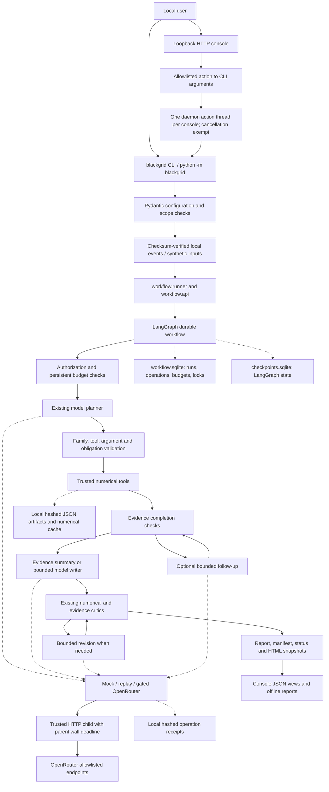

# BLACKGRID — Current architecture

Phase 1 audit, 22 October 2026. This describes the current working tree, including pre-existing uncommitted work, at base revision `e043496720445ac2f0ac79db51532f52159b0071`. It is descriptive engineering evidence, not a production-readiness certification. See [source inventory and hashes](docs/production_phase1/source_snapshot.json), [baseline tests](baseline_test_report.md), [gaps](production_gap_analysis.md), and [roadmap](production_roadmap.md).

## Scope and evidence

The recursive source inventory contains 64 Python modules and 12,557 lines, plus 38 test modules, an HTML console template, configurations, protocols, scripts, and historical reports. All source modules were parsed for imports and top-level symbols; execution, persistence, provider, interface, validation, and analytical boundaries received targeted source review. This is not a line-by-line formal verification. Historical reported metrics were not rerun as scientific studies.

Raw data, private receipts, credentials, sealed instances/answer keys, the virtual environment, Git internals, caches, generated outputs, old backups, and large temporary artifacts were excluded from content review. Existing tests may use local CollegeMsg and small generated fixtures; no new dataset experiment was launched. `PROJECT_CONTEXT.md` still describes an early planning handoff; current code and newer implementation records establish a substantially implemented local application.

## Actual execution flow

Refusals, denied authorization, exhausted budgets, pauses, partial results, and failures can terminate or interrupt the path before reporting. `tool_only` deliberately bypasses criticism as an evaluation condition. Follow-up is conditional on family and planning mode. The current default supports evidence templates; the model-writing option remains available. Phase 1 changes none of these policies or the number/sequence of model calls.

## Interfaces

Entry points are declared in `pyproject.toml` and implemented in `src/blackgrid/cli.py` and `__main__.py`. Commands cover validate/run/status/resume/cancel/deny/reconcile, console/UI, ingestion, mock pilots and historical sprint evaluations, prediction evaluation/rolling/confirmation, forecasting, and synthetic research demonstrations. Evaluation commands are distinct from routine serving; some require paid authorization and must never be executed merely to start a deployment.

`src/blackgrid/workflow/api.py` is an in-process Python API, not a REST service. The actual server is `ThreadingHTTPServer` in `src/blackgrid/console/server.py`, bound to `127.0.0.1`:

| Method and route | Existing function | Current access boundary |
|---|---|---|
| GET `/` | Console HTML, including session action token | Host-header allowlist; local browser |
| GET `/api/index` | Local run index and aggregate allowance status | Host-header allowlist |
| GET `/api/run?id=…` | Run view | Host-header and contained run-ID resolution |
| GET `/api/pilot?id=…` | Pilot view | Host-header and contained run-ID resolution |
| GET `/api/forecast?id=…` | Forecast view | Host-header and contained run-ID resolution |
| GET `/api/job?id=…` | In-memory console action status | Host-header allowlist |
| POST `/api/action` | Start/pilot/resume/cancel/deny/reconcile | Host-header, session token, JSON/body checks, action allowlist |

The 4,096-byte action-body limit, question validation, same-origin headers, XSS-safe embedding/text rendering, path containment, and single-action admission are useful local protections. The session token is an action/CSRF boundary, not user authentication. Read routes have no per-user authorization. There are no existing versioned production job routes, identity provider, tenant ownership checks, TLS termination, health endpoints, or per-client rate limiter in this server. Do not expose it remotely as-is.

## Components and preserved capabilities

| Area | Source and responsibility | Scientific/operational boundary |
|---|---|---|
| Contracts | `contracts.py` | Frozen, extra-field-forbidding schemas; evidence labels, budgets, rights, scope and outcome validation |
| Input data | `data/collegemsg.py`, `datasets.py`, `ingestion.py`, `synthetic.py` | Checksums; event preservation; fixed first-window projection; separately configured full scope; approved dataset registry |
| Planning and reporting | `agent/inquiry.py`, `roles.py`, `critic.py`, `report.py` | Existing family routing, tool obligations, scope refusals, evidence linkage and revision rules |
| Tools | `agent/tools.py` | Strict registry; unknown-code/answer-key rejection; size/prerequisite checks; verified cache; aggregate model evidence |
| Community science | `analysis/experiment.py`, `sensitivity.py`, `methods.py` | Louvain null comparison and missing-edge sensitivity; optional Leiden comparison; preserved parameters/seeds |
| Structural science | `analysis/structural.py` | Centrality, partitions, bridges and ranking sensitivity |
| Behavioral science | `analysis/behavior.py` | Directed-window features, fixed KMeans clusters, cosine neighbors, robust-deviation candidates; local identifier rows |
| Prediction | `prediction/` | History-only features, explicit new/repeat candidate universes, heuristics/logistic ranking, rolling evaluation and saved selection evidence |
| Research examples | `analysis/reliability.py`, `decisions.py`, `causal.py`, `agent/research.py` | Synthetic calibration/Beta updates/decisions and conservative identification review; no real causal effect certification |
| Workflow | `workflow/engine.py`, `api.py`, `runner.py` | Durable graph, identity checks, cancellation boundaries, receipts, budget accounting, recovery and finalization |
| Persistence | `workflow/store.py` | Transactional SQLite operation ledger and host-local run leases |
| Presentation | `console/data.py`, `render.py`, `ui.py`, `template.html` | Artifact views, local rankings, layouts, offline snapshots |
| Evaluation | `evaluation/`, `tests/`, `protocols/`, `scripts/` | Numerical/scientific and engineering checks; historical frozen protocols and reviewer limitations |

Forecast scores are uncalibrated rankings. Behavioral candidates do not identify fraud or wrongdoing. Bayesian examples and intervention demonstrations use synthetic assumptions; they do not establish CollegeMsg causal effects. Existing critic checks are not independent scientific ground truth.

## Persistence, recovery and configuration

Each runs root holds `workflow.sqlite` and `checkpoints.sqlite`; per-run files include configuration, graph/protocol identities, artifacts, receipts, status, traces, reports, and manifests. `OperationStore` uses `BEGIN IMMEDIATE` transactions with a 30-second connection timeout. Operation states include prepared/dispatched/succeeded/failed_known/billing_unknown. Reservations and historical spend survive restarts. Uncertain external billing pauses for reconciliation rather than automatic resend. Saved receipts and tool outputs are checked against recorded hashes.

Run ownership uses local PIDs and fencing checks. The source explicitly disallows sharing that ownership mechanism across hosts. Checkpoints, operation rows and files span separate persistence boundaries; recovery logic is important and must be preserved. Console action IDs/status are a different, transient dictionary and disappear on server restart.

Core workflow artifacts use fsync plus temporary-file replacement; cache entries have identity/hash/schema validation and corrupt-entry quarantine. Some prediction/model-cache/UI files use direct writes. Atomic visibility of one file is not a transaction across both SQLite databases and the artifact tree.

Configuration is validated JSON plus CLI arguments. `.env` is used for authorized live provider setup; its contents were not inspected. `uv.lock` records dependencies; Python is constrained to 3.11. Repository-relative defaults are calculated from `Path(__file__).parents[3]`; source-layout paths and saved research/forecast evidence are deployment dependencies. A wheel installed elsewhere must not be presumed equivalent without tests.

## Production boundary

The present shape is one local application with durable scientific workflows, not a distributed multi-tenant service. Useful existing controls should be wrapped and verified before expansion. Single-host SQLite is a reasonable first deployment candidate; a second queue/checkpoint system, Redis, PostgreSQL, graph database, Kubernetes, or a new agent framework is not currently justified by measured workload evidence. Proposed engineering changes and their gates are in [production_roadmap.md](production_roadmap.md).
