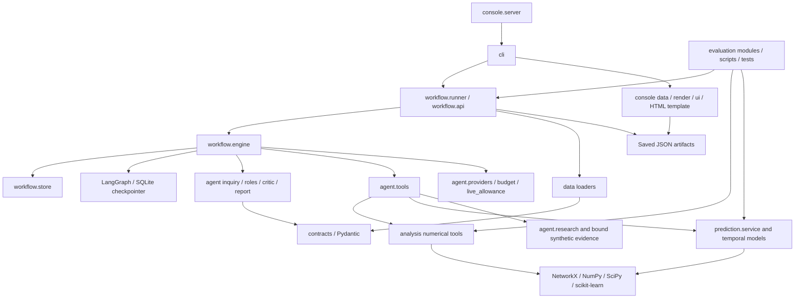

# BLACKGRID — Dependency and preservation map

Phase 1, 22 October 2026. Full source imports and symbols: [source_snapshot.json](docs/production_phase1/source_snapshot.json). The graph below summarizes logical dependency direction, including lazy imports; it is not a claim that runtime imports form an acyclic graph.

## Installed environment observed

These are installed versions in the existing `.venv`, not newly resolved recommendations. No dependencies were installed or upgraded.

| Package | Installed version | Role |
|---|---|---|
| Python | 3.11.9 | Required runtime family is `>=3.11,<3.12` |
| blackgrid | 0.1.0 | Existing local package |
| langgraph | 1.2.12 | Durable workflow orchestration |
| langgraph-checkpoint-sqlite | 3.1.1 | Checkpoint persistence |
| networkx | 3.6.1 | Graph algorithms and temporal topology |
| numpy | 2.4.6 | Numerical arrays |
| pydantic | 2.13.5 | Validated contracts |
| scikit-learn | 1.9.1 | Logistic models, scaling, KMeans and diagnostics |
| scipy | 1.17.1 | Statistical distributions and numerical routines |
| igraph | 0.11.9 | Optional graph-method comparison |
| leidenalg | 0.10.2 | Optional Leiden comparison |
| threadpoolctl | 3.7.0 | Imported directly by behavioral tools; currently supplied transitively |
| pytest | 9.1.1 | Existing regression suite |

`pyproject.toml` lists seven primary runtime dependencies, a `methods` extra, pytest development dependency, and hatchling build backend. `uv.lock` freezes the resolution; `[tool.uv].exclude-newer` is a historical resolution cutoff, not proof of current vulnerability status. No separate LLM SDK, web framework, external queue, external database or monitoring library is required by the current source. If production packaging relies directly on threadpoolctl, make its direct dependency status explicit during the approved packaging work; do not upgrade versions incidentally.

## Runtime assets outside the Python package

| Asset | Consumer | Packaging / preservation rule |
|---|---|---|
| `configs/*.json` | CLI and runner | Preserve validated configs and scientific scope; don't bake live credentials |
| `protocols/` | Evaluations and provenance | Version and include only required protocol assets |
| `uv.lock`, source revision and dirty hashes | Environment capture | Preserve current lock and audited snapshot |
| `console/template.html` | Renderers | Verify inclusion and loading in built image/package |
| Local CollegeMsg file and manifest | Dataset loader | Read-only explicit input mount; no image redistribution |
| `runs/workflow.sqlite`, `runs/checkpoints.sqlite` | Workflow API | Persistent single-host storage; backup with artifact consistency |
| Per-run artifacts and `ops/` receipts | Resume, reports, replay | Preserve identity/hashes, restrict local access, retain failures |
| `runs/cache/`, `runs/forecast_models/` | Numerical/forecast cache | Preserve distinction between cache and authoritative results; test corruption/rebuild |
| `runs/sprint6-v1/selection.json` and related saved evaluation outputs | Forecast service | Required evidence must be explicitly provisioned; don't run paid/new evaluations on startup |
| `results/sprint06-v2/summary.json`, `results/sprint06-v3-bitcoin/summary.json` | Forecast model promotion | Missing evidence may change the selected method; mount reviewed artifacts with hashes |
| `runs/sprint7-final/` with pinned manifest | Research tools | Bind existing verified synthetic evidence; no substitute real-data claims |
| `.env` or equivalent secret input | Live provider only | Exclude from image/context/reports; opt-in live execution only |

## Change boundaries

| Boundary | Keep unchanged | Suitable engineering addition after approval | Regression evidence |
|---|---|---|---|
| Scientific kernels | Methods, seeds, precision, candidate rules, windows, nulls | Process/container execution wrapper | Known-answer, invariant, numerical-parity tests |
| Agent behavior | Existing prompts/models, planner route and call order, critic rules, evidence/model writer choice | Correlation and telemetry adapters | Planner/obligation, writer, critic, routing and refusal suites |
| Provider adapter | Request semantics, limits, uncertain-billing treatment | Secret delivery, bounded scheduling and diagnostics | Fake transport contracts, budget and reconciliation tests |
| Workflow engine | Existing graph/checkpoints/operation IDs and receipts | Durable job admission and lifecycle adapter | Crash points, resume identity, cancellation, locks and receipt integrity |
| Persistence | Historic spend, run identities, immutable evidence | Coordinated backups; explicit, tested schema migrations | Recovery, compatibility and restore tests |
| Console | Current local commands, action guards and report interpretation | Deployment wrapper first; secured remote API later | Existing console/UI tests plus production contracts |
| Evaluation | Frozen splits, answer-key isolation and thresholds | CI/test harness and machine-readable reports | Preserve failures and previously inspected-test status |

A distributed queue, PostgreSQL migration, Kubernetes, new graph backend or agent-framework rewrite is not part of the Phase 2 proposal. Source-root coupling and single-host leases make a source-layout, single-container deployment the lowest-risk initial option. Verify Linux/native numerical behavior before claiming portability.
