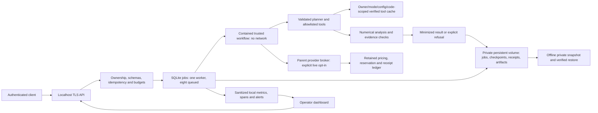

# Released single-host architecture

The API, roles and worker controller share one service; there is no distributed queue, graph database, independent agent fleet or inference server. Workers execute trusted validated numerical tools, never model-generated shell/Python. Raw identifiers/events and generator truth stay out of external model prompts and public evidence. The parent broker is the only live transport path under retained authorization; mock startup and release tests incur no provider calls.

Release checks run in separate disposable containers. Synthetic staging/load state is distinct from production. CI has no production mounts or deploy credentials. Local promotion checks exact image/source/evidence identities and configuration before the idle-only backup/deploy/restart/rollback sequence. See [the original implementation map](../../architecture.md) for component details and [the handbook](operations.md) for operational boundaries.
