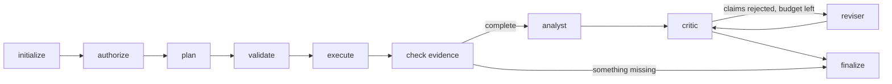

# How a BLACKGRID investigation runs (Sprint 2)

This is a plain-English guide to the workflow, how to watch it, and how it recovers after an interruption. The exact rules are in `protocols/sprint02_workflow.md`.

## The steps

An investigation is a fixed series of steps. The current step is saved after every one.



| Step | Who decides | What happens |
|---|---|---|
| initialize | code | Reload the graph from its source and check it is the same graph (fingerprint). |
| authorize | code + you | Live mode only. Without a valid permission, the run **pauses** here, before any paid call. |
| plan | AI (planner) | Suggest which allowed tools to use. |
| validate | code | Refuse causal or invalid requests. Add any analysis the protocol requires but the planner forgot. |
| execute | code | Run the tools one by one. Each result is saved with its fingerprint. |
| check evidence | code | Every required analysis must exist with an unchanged fingerprint. If not, the run is **partial** and stops here. |
| analyst | AI | Write short claims, each pointing at its evidence. |
| critic | code | Check every claim against seven fixed rules. |
| reviser | AI | Rewrite rejected claims. At most two rounds, within budget. |
| finalize | code | Decide the outcome and write the report, the manifest, and the console snapshot. |

The AI makes choices and writes the words. **Permission, money, completion, and stopping are always decided by code**, never by the AI.

## Outcomes

| Outcome | Meaning |
|---|---|
| completed | Every required analysis ran and the report passed its checks. A correctly refused request also counts as completed. |
| partial | It finished, but a required analysis is missing, so only part of the question is answered. |
| abstained | The data failed a scientific rule written in advance (for example, the graph was too small). |
| failed | A tool, provider, or integrity check failed. |
| budget_exhausted | The next call would break a money, call, or token limit. |
| paused | Waiting for you, either for permission or to resolve an uncertain paid call. |
| denied | You refused permission. |
| cancelled | You cancelled it. |

## Restart example

Suppose your computer shuts down while an investigation is running.

1. **Each finished step is already saved.** The step history is stored in `runs/checkpoints.sqlite`. Every AI call and tool call has its own record in `runs/workflow.sqlite`, written *before* the call starts.
2. **Find the run:**
   ```bash
   uv run --frozen blackgrid status
   ```
3. **Look at it:**
   ```bash
   uv run --frozen blackgrid status RUN_ID
   ```
4. **Continue it:**
   ```bash
   uv run --frozen blackgrid resume RUN_ID --force-unlock
   ```
   - `--force-unlock` is needed only because the crashed program never released the run. Use it only when that program has really stopped. Without it, a second copy trying to run the same investigation is turned away.
   - Steps that already finished are **reused, not repeated**. A finished AI call is never sent again, and its cost is not charged again.
5. **One case cannot be decided automatically.** If the computer died *after* an AI request was sent but *before* its reply was saved, nobody can know whether the provider answered and charged for it. The run pauses and asks you to choose:
   ```bash
   uv run --frozen blackgrid reconcile RUN_ID --retry
   ```
   `--retry` tries once more within the limits. `--stop` ends the run. Either way, the uncertain call stays counted at its full reserved price.

Money, call, and token limits are added up from the saved records every time. Restarting never resets them.

## Paid (live) runs

- **Starting without `--allow-paid` pauses** before the first paid call:
  ```bash
  uv run --frozen blackgrid run configs/collegemsg_live.json
  ```
- **Approve:**
  ```bash
  uv run --frozen blackgrid resume RUN_ID --allow-paid
  ```
  The permission covers only this run's model, data, protocol, tools, and cost ceiling, for 24 hours.
- **Refuse:**
  ```bash
  uv run --frozen blackgrid deny RUN_ID
  ```
- **Stop at the next safe step:**
  ```bash
  uv run --frozen blackgrid cancel RUN_ID
  ```

Changing the model, the data, or the protocol stops a run from resuming; start a new run instead (`--parent RUN_ID` records the link). Spending limits:

- USD 0.50 per run;
- USD 1 for Sprint 2;
- USD 10 for the whole project, including Sprint 1's USD 0.0051.

## The console

Start the live console:

```bash
uv run --frozen blackgrid console
```

Then open http://127.0.0.1:8765.

It shows every run and updates while runs are in progress:

- the current step;
- required, completed, and missing analyses;
- remaining limits;
- pause reasons;
- the experiment, the network, the missing-data test, the agent trace, claims, the report, and the budget.

It can start **mock** runs and the pilot, and resume, cancel, deny, or reconcile runs. It can **never** start or approve paid calls; those stay on the command line.

Every finished run also saves the same console as an offline snapshot (`runs/<run>/report.html`), and `runs/index.html` lists every run. Rebuild all snapshots:

```bash
uv run --frozen blackgrid ui
```

## Honest limits

- Exactly-once paid calls cannot be guaranteed. The ambiguous case pauses instead of guessing.
- Cancelling is cooperative. A tool computation or AI request that is already running finishes first.
- The SQLite files are not a security sandbox. There is still no OS isolation, and memory is not capped on Windows.
- Checkpoints and saved replies are sensitive local files. They are git-ignored and never uploaded.
