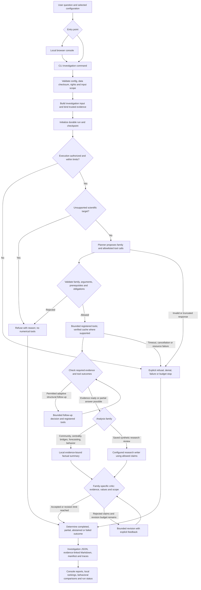
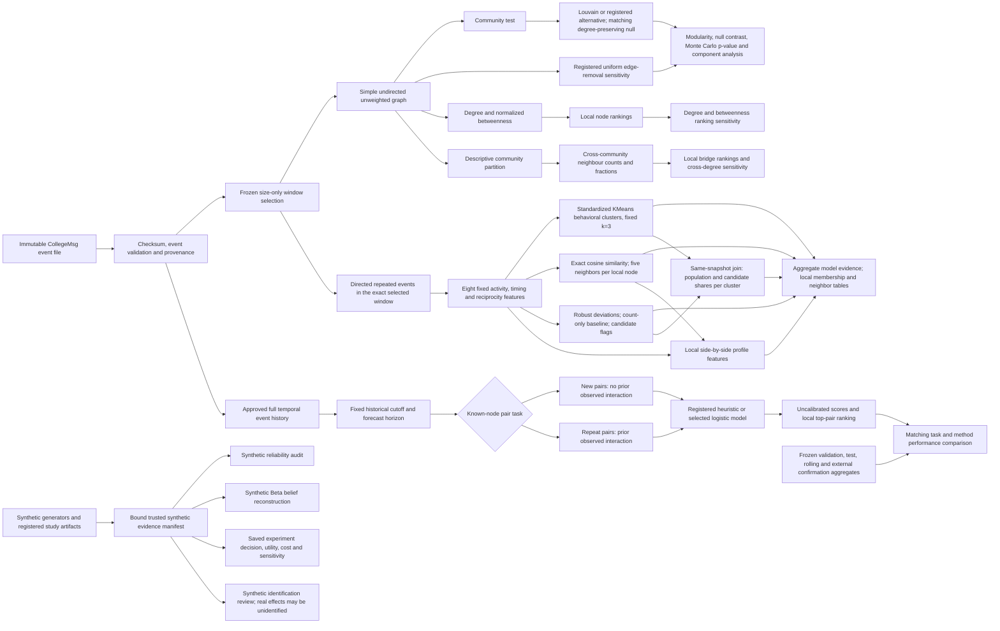
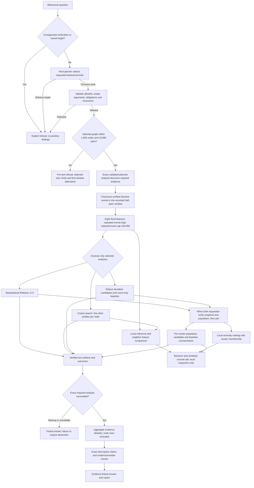
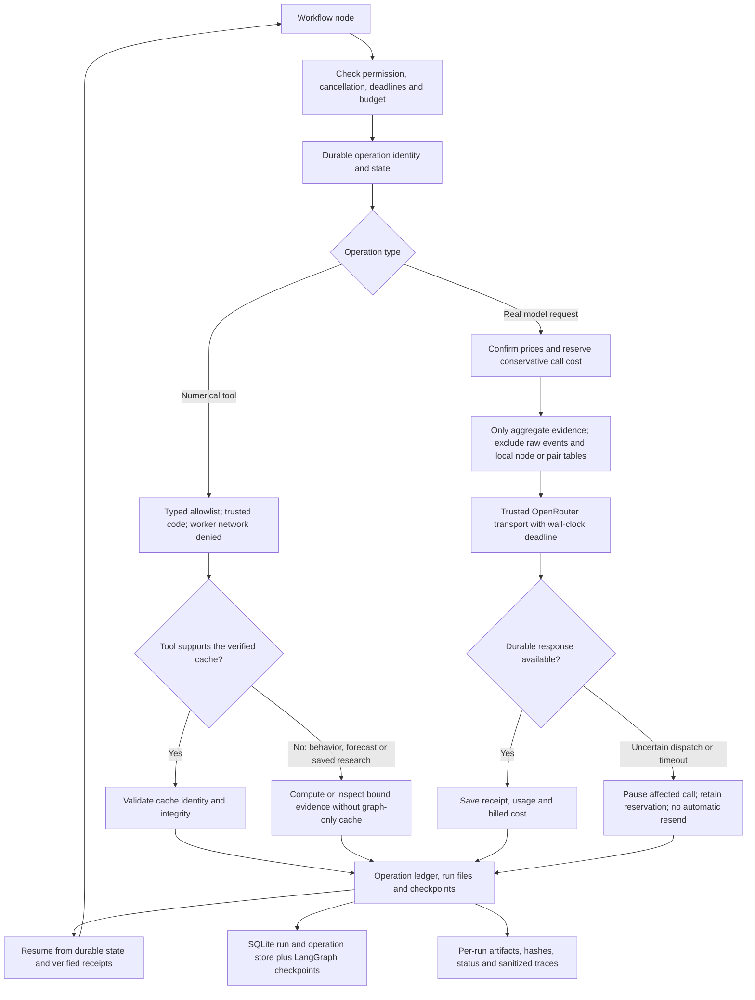

# BLACKGRID system flowchart

Current implemented system through the Sprint 8 repairs, based on `src/blackgrid/`. Versioned [guides and reports](docs/) describe implemented behavior; ignored local sprint plans under `sprints/` may include future work.

## Investigation from question to report

This diagram follows the validated investigation path. Tool-only and scripted comparison modes are retained for development/evaluation and have different criticism and writing behavior. A valid refusal can be a completed answer. Missing required evidence is exposed as partial, abstained or failed rather than silently treated as success.

Live mode uses the real provider for planning. The current validated community, structural, forecast and behavioral summaries are local templates checked against evidence; they do not require an extra model rewrite. Mock mode is the default development option, and replay uses matching saved receipts. Live execution requires explicit authorization and current pricing.

## Data and registered analysis families

The first-window structural experiment and full-dataset exploratory structural analysis have separate specifications. Forecasting uses its bound temporal history, not the structural window label. Repeated events are retained in the temporal data; the static projection aggregates them into unique pairs. Unobserved pairs are not automatically true negative edges. Rankings and graph position do not establish behavioral influence, friendship or causal effects.

Research tools inspect registered synthetic evidence; they do not autonomously run new real-world experiments or turn synthetic posteriors into CollegeMsg probabilities. Predictive scores are rankings, with no claim of calibrated individual probabilities.

## Behavioral planning, comparisons and refusals

Grouped outlier requests require both cluster memberships and candidate flags, including the population denominators. Explicit anomaly exclusions are honored. Unknown keyword obligations do not expand a valid narrow semantic plan to every method; features alone cannot satisfy an analysis request. Snapshot/population mismatches are rejected and unsuitable populations abstain. Behavioral tools bypass the graph-only cache because event frequency and timing affect their results.

Profile comparisons expose counts, distinct contacts, reciprocity and temporal concentration locally. The joined aggregate shares are descriptive candidate fractions, not calibrated probabilities or evidence of fraud. Proof of criminal/malicious identity and causal influence are unavailable from these observations. The full CollegeMsg graph exceeds the behavioral node/pair caps, while the approved first window fits; full-scope structural analysis and temporal forecasting retain their separate contracts.

## Persistence, privacy and paid-call controls

These are application controls around trusted tools, not a claim that arbitrary generated code is sandboxed. Workers execute registered implementations. Project and investigation caps include earlier spending and unresolved reservations. Source/configuration hashes and operation receipts support reproducibility; they do not make a critic's approval independent scientific validation.

## Evaluation and development loop

```mermaid
flowchart LR
    Protocol["Freeze questions, expected targets, rubric, budget and stopping rules"] --> Snapshot["Record source, configuration, protocol and evaluator hashes"]
    Snapshot --> Execute["Attempt every case once under the frozen protocol"]
    Execute --> All["Retain passes, refusals, failures, timeouts and costs"]
    All --> Numeric["Independent local numerical and artifact checks"]
    Numeric --> Semantic["Review whether the final answer addresses the requested target and scope"]
    Semantic --> Report["Publish local scorecard with category totals and limitations"]
    Report --> Repair["Separate development repairs and focused verification"]
    Repair --> Next["Freeze a new evaluation; preserve earlier outcomes"]
    Next --> Protocol
```

Fresh wording on reused graphs checks system behavior; it is not a new independent dataset or a causal comparison between software versions. Numerical correctness and answer completeness are graded separately. Earlier outcomes remain recorded after repairs.

| Evidence | Recorded result and scope |
|---|---|
| [General evaluation before Sprint 8](docs/current_system_eval_v7.md) | 23/24 strict passes; one research response truncated. |
| [Sprint 8 full evaluation](docs/sprint08_system_evaluation_v1.md) | 22/24 strict passes; all supported numerical results correct, two requested comparisons incomplete. |
| [First repair follow-up](results/sprint08-repairs-followup-v1/summary.json) | 10/12; implicit grouped comparison and fraud-proof handling exposed further gaps. |
| [Final targeted confirmation](docs/sprint08_repairs_report.md) | 12/12, including nine supported requests with exactly their required tools; development confirmation on reused data, with one case inspected before dispatch. |
| [Engineering verification](docs/current_test_status.md) | 530 full-suite passes; 71 final focused passes after the last exclusion refinement. |

HTML generation was excluded from timed evaluation workers. Actual browser checks separately verified changing the local reference profile, side-by-side feature values, grouped candidate shares and the membership column. These results do not establish real anomaly precision/recall or verified behavioral groups. The final auditor's missing-trace error for a zero-call refusal and its ledger-verified supplement are preserved in the repair report.

## Source map

| Responsibility | Main implementation |
|---|---|
| Commands and local UI | [cli.py](src/blackgrid/cli.py), [console/server.py](src/blackgrid/console/server.py), [console/data.py](src/blackgrid/console/data.py) |
| Validated configuration and experiment contracts | [contracts.py](src/blackgrid/contracts.py) |
| Dataset loading and graph projection | [data/collegemsg.py](src/blackgrid/data/collegemsg.py) |
| Orchestration and finalization | [workflow/runner.py](src/blackgrid/workflow/runner.py), [workflow/engine.py](src/blackgrid/workflow/engine.py) |
| Durable run and operation accounting | [workflow/store.py](src/blackgrid/workflow/store.py), [agent/budget.py](src/blackgrid/agent/budget.py) |
| Family selection and plan obligations | [agent/inquiry.py](src/blackgrid/agent/inquiry.py), [agent/roles.py](src/blackgrid/agent/roles.py) |
| Registered tools and scientific criticism | [agent/tools.py](src/blackgrid/agent/tools.py), [agent/critic.py](src/blackgrid/agent/critic.py) |
| Community experiments and structural metrics | [analysis/experiment.py](src/blackgrid/analysis/experiment.py), [analysis/structural.py](src/blackgrid/analysis/structural.py) |
| Behavioral features, clustering, neighbors, anomaly candidates and joined aggregates | [analysis/behavior.py](src/blackgrid/analysis/behavior.py), [console/template.html](src/blackgrid/console/template.html) |
| Temporal prediction and matching evaluation | [prediction/service.py](src/blackgrid/prediction/service.py), [prediction/rolling.py](src/blackgrid/prediction/rolling.py), [prediction/claims.py](src/blackgrid/prediction/claims.py) |
| Saved synthetic research reviews | [agent/research.py](src/blackgrid/agent/research.py), [analysis/reliability.py](src/blackgrid/analysis/reliability.py), [analysis/decisions.py](src/blackgrid/analysis/decisions.py), [analysis/causal.py](src/blackgrid/analysis/causal.py) |
| Provider integration and deadlines | [agent/providers.py](src/blackgrid/agent/providers.py), [agent/http_transport.py](src/blackgrid/agent/http_transport.py) |
| Evidence-linked reports | [agent/report.py](src/blackgrid/agent/report.py) |
| Sprint 8 live evaluation and independent audits | [evaluate_sprint08.py](scripts/evaluate_sprint08.py), [repair follow-up](scripts/evaluate_sprint08_repairs.py), [final confirmation](scripts/evaluate_sprint08_repairs_v2.py) |

## Document layout

- `sprints/`: ignored local sprint plans, including Sprint 8; implementation evidence is versioned under `docs/` and `protocols/`.
- [docs/](docs/): guides, implementation reports, repair notes and the decision log.
- [protocols/](protocols/): versioned scientific and evaluation contracts.
- `runs/`: local execution records, private rankings and reproduction artifacts; historical records remain in place.
- `results/`: minimized saved evaluation outputs.
